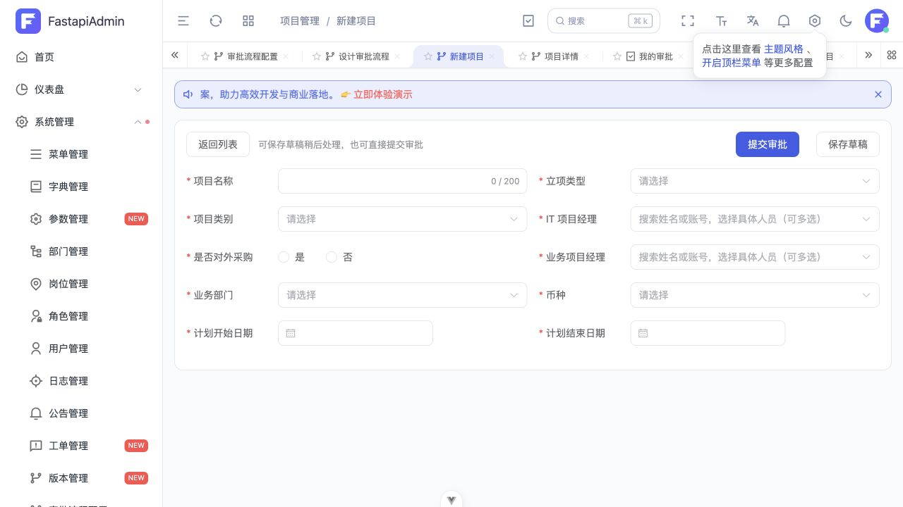
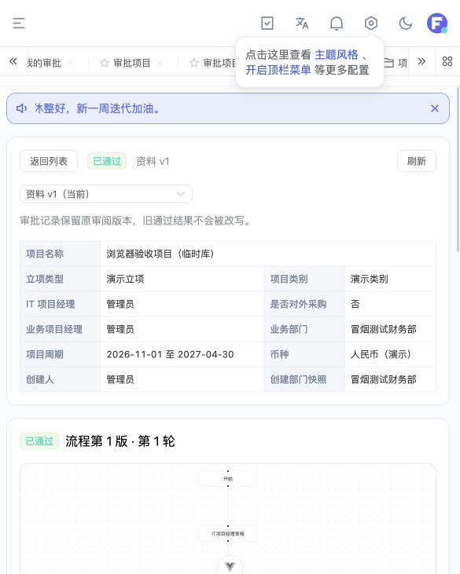

# 项目模块与审批流程：使用与源码入口

这份说明对应当前已经写入正式工程的实现，不是隔离学习目录中的示例。

## 1. 做了什么

- 项目列表、创建、草稿编辑、详情、资料历史版本。
- 系统管理中的审批流程配置：画图、保存草稿、校验、发布不可修改的版本、绑定项目模块。
- 串行、嵌套并行且全部汇合、按优先级只走一条的条件分支和默认路线。
- 系统角色与业务角色多选、人员并集去重、任一通过/全部通过、节点完成前一票否决。
- 角色成员的多个管理部门、创建部门快照、向上查找最近一级负责人。
- 我的待办/已办、通过、两种驳回、嵌套定点返回、有限撤回、缺人阻塞与管理员重试。
- 对象级查看/修改权限、资料版本、流程版本、幂等命令、并发版本和事务内业务审计。

第一版没有增加转办、加签、抄送、催办、超时、已通过项目作废功能，也没有改造全局登录、Redis 或数据库配置。

## 2. 首次使用：管理员需要配置真实业务资料

### 第一步：维护三类字典

在现有字典管理维护以下字典的有效选项：

| 字典编码 | 含义 |
| --- | --- |
| `project_initiation_type` | 立项类型 |
| `project_category` | 项目类别 |
| `project_currency` | 币种 |

初始化只补齐字典类型，不虚构公司的正式选项。类型和条目均须启用。流程条件比较的是条目的 **value**，不是显示标签。立项类型与项目类别独立。

两个项目经理都多选；业务部门单选；项目周期是开始日期和结束日期；是否采购是真正的布尔值。

### 第二步：配置系统角色与角色成员

1. 在现有角色管理准备“部门负责人”等实际使用的系统角色。
2. 在用户管理给人员分配角色。
3. 打开“系统管理 → 审批流程配置 → 流程与模块绑定”。先选择部门负责人系统角色并保存；此时可以暂不选择默认流程。
4. 打开“成员管理部门”，选择角色，为每个人选择其管理部门并保存。角色管理的“管理部门”操作也会跳到这里。

“本人所属部门”和“管理部门”是两个概念。某人属于技术部，也可以管理财务部；同一人在不同角色中的管理范围分别保存。

### 第三步：检查业务角色

默认提供：

| 业务角色编码 | 找人方法 |
| --- | --- |
| `PROJECT_IT_MANAGER` | 当前项目的 IT 经理 |
| `PROJECT_BUSINESS_MANAGER` | 当前项目的业务经理 |
| `CREATOR_DEPT_MANAGER` | 从创建部门快照开始，查最近一级有人的部门负责人 |

可以新增业务角色，复用“单据人员字段”或“创建部门最近负责人”策略。第一版开放的人员字段为 IT 经理、业务经理、创建人。不允许配置任意 Python/SQL 脚本；新增真正不同的业务找人方式，需要开发适配。

### 第四步：设计、发布、绑定流程

1. 打开默认“项目审批流程”的“设计/查看版本”。
2. 默认是开始 → IT 经理 → 业务经理 → 部门负责人 → 结束，可直接调整。
3. 点击节点配置名称、任一/全部通过、多个系统/业务角色。拖动节点的位置，拖拽连接点连接节点。
4. 条件分支的每条非默认出口都配置条件和唯一优先级（数值小的先判断），并指定且只指定一条默认出口。
5. 并行分叉指定独立配对的并行汇合；所有分支到齐后才继续。不可画回环，退回使用驳回操作。
6. 点击“校验配置”，修复提示；保存草稿后发布新版本。
7. 回配置首页，选择项目模块默认流程并保存绑定。

发布时冻结图和业务角色规则；角色成员与管理部门仍在节点进入时查询。修改业务角色规则或默认负责人角色后，如希望影响新项目审批，应再发布版本。首次提交过的项目不跟随新版本；从未提交的草稿会在首次提交时选择当前绑定的发布版。

### 第五步：分配菜单和接口权限

使用现有角色权限功能按需要授权，不会自动把所有项目或管理员权限发给普通用户。

- 项目：`module_business:project:query/detail/create/update/submit/withdraw/delete`。
- 流程：`module_system:workflow:query/configure/publish/recover`。
- 配置人员通常需要 `query + configure`；发布人员需要 `query + publish`，可只发布已保存草稿。
- 普通审批人无需项目列表/详情或流程配置权限。登录后从顶栏“我的审批”进入，只能访问自己的任务。

变更角色授权后，重新登录以刷新已有权限缓存。菜单权限与对象权限是两道检查：即使有“编辑项目”接口权限，也不能编辑别人的项目。

## 3. 实际业务操作

| 操作 | 预期 | 第一排查点 |
| --- | --- | --- |
| 项目列表导出 | 点击“导出”下载 Excel；列为项目名称、立项类型、业务部门、状态、创建人、创建日期，与列表数据列同序；导出全部分页，不含操作列 | 使用最近一次成功加载列表的名称/状态条件，沿用列表查询及对象可见权限；未点击搜索的输入不影响范围 |
| 保存草稿 | 生成草稿和资料 v1，不自动提交，可稍后继续 | 三类字典、经理账号、创建人有效部门 |
| 创建页直接提交审批 | 无需先保存；一个事务创建项目、校验全图找人并发起流程。校验失败整笔回滚，不遗留草稿 | 默认流程是否已发布/绑定、全部分支是否有人 |
| 编辑页保存并提交 | 一个事务保存修改并发起/重新提交；校验失败恢复原有草稿与资料版本 | 创建人、可编辑状态、并发版本以及全图找人 |
| 提交审批 | 全图找人通过后绑定发布版并生成首批待办 | 默认流程是否启用/发布/绑定；错误明确标出缺人节点 |
| 我的待办打开项目 | 只读资料和历史，可办理自己的有效任务 | 任务是否属于本人；是否已暂停、完成或账号失效 |
| 通过 | ANY 立即完成并关闭剩余任务；ALL 等待全部通过 | 任务状态、资料版本、流程并发版本；409 时刷新审阅 |
| 驳回重走 | 不选目标，退起草，提交后从开始走新一轮 | 是否错误携带 target；旧轮次记录不参与新一轮汇合 |
| 定点返回 | 选起草/本轮同分支或公共祖先中已到达的审核节点 | 跨并行分支、未来节点不在目标列表内 |
| 撤回 | 创建人且整个实例尚无任何手动通过/驳回 | 已有审批动作则不可撤回；重走不会清除这个事实 |
| 删除草稿 | 创建人软删除；取消挂起待办并保留历史 | 单据是否在可编辑状态；历史任务仍可只读查看 |
| 重试恢复 | 有恢复权限者修复配置后重试阻塞 | 激活缺人：补齐当前来源；冻结会签失效：恢复原账号 |

项目列表/普通详情只开放给创建人、当前管理部门及其下级部门的负责人、超级管理员。归属按创建时部门，不按业务部门或后续调岗判断。

项目导出接口为 `GET /business/project/export?name=...&status=...`，使用 `module_business:project:query` 权限，与列表共用筛选条件及 ID 倒序，不接受分页作为导出范围。空结果返回只有表头的 Excel；页面在列表为空时禁用导出。字典和部门使用列表相同的快照名称，状态显示中文。全量导出不使用通用工具默认的 10 万条截断，超过单工作表容量时自动分表；项目名称等文本不会作为 Excel 公式执行。列表与导出是两次独立读取，期间若其他人新增、删除或更改项目，数据会反映各自请求时的状态。

定点返回的关键例子：

- D → B：B 通过后直接回 D，不重走 C。
- D → 起草：创建人可以改所有表单字段，再提交仍直接回 D，不重新计算已经跳过的条件分支。
- D → B → 起草：提交回 B，B 通过回 D，逐层完成返回链。
- 并行一支驳回：其余未完成任务暂停；已通过的分支保留旧资料审阅版本。恢复的既有任务保留原名单，但必须审阅当前资料。
- 不回起草就不能编辑项目字段；管理员也不绕过创建人修改限制。

提交预检检查全部审核节点，包括条件不准备走的分支；每次进入节点重新找人，进入后本次名单固定。本人是审批人时也必须手动点击通过。

创建/编辑表单同时提供“提交审批”和“保存草稿”，不要求用户先进入详情页再提交。直接提交须同时具备创建（编辑时为修改）与提交权限；两按钮请求期间互相禁用。同一份表单因超时重试沿用幂等键，防止重复建单或重复发起。



## 4. 后端从哪里开始读

建议按一次请求读完，不从框架底层重新读起：

| 要看什么 | 阅读顺序与停止点 |
| --- | --- |
| 创建草稿 | `business/project/controller.py:project_create` → `service.py:create` → `validate_input` → `crud.py:create_draft` → `save_revision` → `serialize`；看到返回数据即停 |
| 创建并提交 | `controller.py:project_create_submit` → `service.py:create_and_submit` → `create` → `workflow/service.py:submit`；同一请求事务，不提前 commit |
| 列表权限 | `controller.py:project_list` → `service.py:page` → `visible_condition` → `workflow/resolvers.py:managed_department_ids`；先跳过分页外的编辑/删除 |
| 提交 | `workflow/service.py:submit` → `version_for_project` → `resolvers.py:precheck/resolve` → `engine.py:start/activate` → `persist`；先只看 START/APPROVAL 两种节点 |
| 审批通过 | `workflow/controller.py:task_approve` → `service.py:decide/locked_task` → `engine.py:approve/complete_mode`；普通串行先跳过 RETURN_TARGET/RETURN_ORIGIN |
| 并行/条件 | `graph.py:validate_graph/evaluate` → `engine.py:activate` 的 EXCLUSIVE/PARALLEL/JOIN 分支；看作用域 expected/arrivals，不数整张图通过数量 |
| 驳回返回 | `service.py:decide` → `engine.py:targets/reject` → `resubmit_targeted/complete_mode`；按一个 D→B→D 的实例看返回栈 |
| 缺人恢复 | `engine.py:block/retry`；区分未激活节点重新找人与既有会签名单冻结 |

共同前提：路由已认证并做接口权限检查；对象与状态限制仍由 Service 再检查。`db_getter` 提供整个请求事务；这里的 CRUD、引擎不自行 commit。异常时项目、实例、任务、业务审计一起回滚。

核心新机制是 **同一节点可以多次执行，但每次执行有独立 visit 和待办**。节点 key 不能当作唯一任务身份。

表单直接提交接口：`POST /business/project/create-and-submit`（业务字段＋`command_key`）；`PUT /business/project/update-and-submit/{id}`（业务字段＋`expected_version`＋`command_key`）。原有保存草稿和已保存项目的提交接口继续保留。

## 5. 物理结构与设计计划的对应

共新增 13 张表：

- 项目：`biz_project`、`biz_project_member`、`biz_project_revision`。
- 配置：`wf_definition`、`wf_version`、`wf_binding`、`wf_business_role`、`sys_user_role_managed_dept`。
- 运行：`wf_instance`、`wf_visit`、`wf_task`、`wf_action`、`wf_command`。

按原计划允许的“职责紧密可合并”原则，轮次、执行 token、并行作用域、返回链存在 `wf_instance.state` 的 JSON 内，不额外拆表。它们都有独立逻辑 ID；重走时归档旧轮次，不只存在进程内存或 Redis。节点执行、人员任务、业务动作则独立存表。

项目主表是当前资料；不可覆写的 revision 是当时资料。每个决定记录实际审阅 revision，每次 visit 记录进入时资料和冻结名单。前端可切换旧资料，查看旧版本时禁止审批。

写命令锁顺序为项目 → 实例 → 任务，另带并发版本和幂等键。SQLite 不证明 MySQL 行锁竞争正确；生产部署仍应在独立目标库做并发压测。JSON 轮次归档会随历史增长，大规模长期运行可进一步归一化拆表，但不能丢弃这些执行身份。

## 6. 迁移与回归证据

迁移文件：`backend/app/alembic/versions/2026_10_25_1533_d6849f0dd210.py`。upgrade 只新建本模块表和索引，不删除既有表。

本地已有开发服务按仓库原有启动逻辑自动应用迁移，实际 MySQL head 已核对为 `d6849f0dd210`；使用与 Alembic 相同的受管表过滤规则，只读对比结果为零结构差异。未在实际 MySQL 上执行 downgrade。

已实际执行：

2026-10-25 最终回归结果：后端 **311 passed，另有 61 个 subtests 通过**；前端 **50 passed**，类型检查与最终构建通过。后端两个警告来自既有 OBS SDK 的 TLS 弃用提示。

2026-10-26 补充“表单直接提交”后的回归：后端 **326 passed，另有 61 个 subtests 通过**；前端 **64 passed**，类型检查、ESLint 和开发模式构建通过。新增用例覆盖原子创建/修改并提交、校验失败回滚、同键重试、权限交集、并发版本与原流程版本沿用。

2026-10-29 增加项目列表全量导出：清理临时测试前，后端 **335 passed，另有 61 个 subtests 通过**；前端 **71 passed**，类型检查、作用域内 ESLint/Prettier/Stylelint 通过。临时用例实际读取导出的工作簿，覆盖跨分页数量与顺序、名称/状态筛选、创建人/管理部门/管理员可见范围、软删除排除、空表头、公式文本安全、100001 行不截断及分工作表保存；前端覆盖已应用筛选、分页不传入导出、重复点击、失败重试和旧查询晚到。验证后已按用户要求删除本次新增测试文件及追加用例，保留仓库原有测试；上述数量是清理前的历史结果。本次未执行服务器发布或人工浏览器下载验收。

- 后端全量 pytest；Schema/CRUD 独立测试也单独运行过。
- 临时内存 SQLite 上真实执行本次增量 upgrade/downgrade，既有表和哨兵数据保留、升级后模型零漂移。
- 前端类型检查、单测、作用域内 ESLint/Stylelint、Vite 构建。
- 浏览器临时库：发布 → 绑定 → 九项字段创建 → 提交 → 三个节点手动通过 → 列表显示已通过 → 历史只读。

测试命令在仓库现有依赖下运行：

```sh
# backend 目录
LOGGER_LEVEL=WARNING .venv/bin/python -B -m pytest tests -q -p no:cacheprovider

# frontend/web 目录
node_modules/.bin/vue-tsc --noEmit
node_modules/.bin/vitest run
node_modules/.bin/vite build --mode development
```

`backend/tests/workflow_preview.py` 是可选浏览器测试工具：只创建临时 SQLite 和模拟 Redis，绑定 `127.0.0.1:18001`，不加载开发 MySQL。测试专用登录入口和演示字典只属于该工具，未注册到正式应用。测试隔离了 SQLite 不适用的独立日志写库；正式全局日志不受影响。

未作为已验证证据的内容：真实 Redis 的完整浏览器链路、目标 MySQL 的多连接并发压测、正式业务字典和真实审批人员配置、全部复杂图形的人工点击遍历。复杂分支/返回的正确性证据来自临时库集成测试，而非声称都在浏览器人工跑过。

临时库页面验收截图（不是现有业务库的正式项目）：


