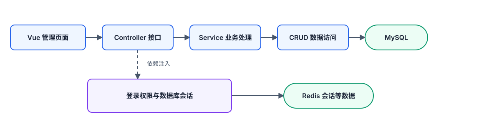

# FastapiAdmin 后端学习计划

适用项目：当前仓库 FastapiAdmin。编写依据：本地源码，Git 基线 `84b0f658`，2026-10-18；已依据评审修订。

这份计划用于学习已经能运行的项目。各节的“学习成果”表示你新增的理解，不表示要重新开发这些功能。你可以完全不写代码，按自己的速度操作页面、阅读代码、观察数据。思考题和拓展都可跳过。

**推荐起点：先浏览项目地图，然后只做第 1.1 小节“请求与响应”。** 不需要先读完登录、权限、数据库封装或部署脚本。

## 一、怎么使用这份计划

每次只跟踪一个操作，例如“点击岗位详情”。学习顺序固定为：

1. 先知道这个功能解决什么问题，正常操作一次。
2. 在浏览器 Network 中找到这次请求，查看地址、参数和返回内容。
3. 按本节给出的顺序阅读关键函数；其他代码暂时折叠。
4. 在日志、MySQL 或 Redis 中寻找与请求对应的证据。
5. 异常实验先预测，再观察结果。可以在心里判断，不必回答问题才能继续。
6. 用文末的简短记录卡留下阅读位置，下次继续。

可以查文档、使用 IDE 跳转定义，也可以直接让 AI 解释一个函数。无需记住所有语法。遇到 `Annotated`、泛型、装饰器等写法时，先弄懂它在这次调用里的作用。

涉及新增、修改、删除的观察，只操作自己创建的“学习用”记录。错误注入、改表和事务故障实验放在独立测试环境，不在当前学习数据库中随意制造故障。

## 二、先认清整个项目

### 2.1 这是怎样的架构

这是一个**前后端分离、按业务模块组织的分层单体项目**。浏览器前端通过 HTTP 调用 FastAPI；后端内部再按接口、业务、数据库访问分工。



图中是典型业务路径。实际项目中，不同模块可能有不同的调用方式；不能仅凭文件名认定每个函数都严格遵守同一种分层。

| 名称 | 在这个项目中的职责 | 可以怎样理解 |
| --- | --- | --- |
| Controller | 声明请求路径、读取参数、接入权限依赖、调用业务并返回响应 | 类似 Java 的 Controller |
| Service | 判断业务规则，组织一次业务操作 | 类似 Java 的 Service |
| CRUD | 构造和执行数据库查询、写入 | 接近 DAO / Repository 的职责 |
| Model | 描述数据库表、字段、关系 | ORM 实体 |
| Schema | 描述输入和输出的数据结构，执行校验和转换 | 接近请求 DTO、响应 DTO |
| Dependency | 为接口提供当前用户、数据库会话等资源 | 通过 `Depends` / `Security` 接入 |

**MySQL 和 Redis 在独立容器中运行，不代表业务采用了微服务。** 当前学习重点是一个后端应用内部如何协作。

### 2.2 技术地图

依赖声明以 [backend/pyproject.toml](backend/pyproject.toml) 为准。下表介绍本仓库的用途，不要求你一次学完。

| 技术 | 在项目里做什么 | 什么时候学 |
| --- | --- | --- |
| Python、FastAPI、Uvicorn | 实现接口、组织应用、运行 HTTP 服务 | 第 1～2 节 |
| Pydantic、pydantic-settings | 输入输出校验、读取配置 | 第 2～3 节 |
| SQLAlchemy 2、MySQL | 表映射、查询、更新、事务 | 第 1、3～6 节 |
| aiomysql、PyMySQL | 分别供异步和同步数据库访问使用 | 第 6 节 |
| Redis | 保存登录会话、字典和参数等缓存 | 第 7、10 节 |
| PyJWT | 生成、验证 Token；配合 Redis 管理会话 | 第 7 节 |
| Loguru、全局异常处理 | 记录运行过程、统一返回错误 | 第 9 节 |
| Alembic | 数据库结构版本管理 | 第 11 节 |
| pytest、pytest-asyncio | 自动验证行为、测试异步代码 | 第 12 节 |
| APScheduler | 定时调度任务；本项目这部分不是 Celery | 第 13 节 |
| Jinja2、OpenPyXL | 代码模板生成、Excel 导入导出相关处理 | 选学 |
| Agno、模型 API、SSE / WebSocket | AI 与实时通信相关能力 | 选学 |
| uv、Typer | 管理 Python 依赖、实现启动命令 | 第 2 节 |
| Vue 3、TypeScript、Vite、Element Plus | 管理后台页面 | 只读与当前接口相关的位置 |
| Docker Compose、Nginx | 组织部署环境、转发请求 | 最后回顾 |

### 2.3 文件夹地图

以下列出主要目录；缓存、虚拟环境和生成文件不需要逐个阅读。

```text
FastapiAdmin/
├── backend/                 Python 后端
│   ├── main.py              启动命令入口
│   ├── app/
│   │   ├── __init__.py       创建应用，注册组件，管理启动与退出
│   │   ├── api/v1/           汇总业务路由
│   │   ├── modules/          按业务领域组织的代码
│   │   │   ├── system/       登录、用户、岗位、角色、菜单、部门等
│   │   │   ├── monitor/      在线用户、缓存、服务器、健康检查
│   │   │   ├── task/         定时任务、任务节点、存储与传输相关功能
│   │   │   ├── generator/    代码生成
│   │   │   ├── ai/           AI 聊天相关能力
│   │   │   └── common/       文件等公共业务接口
│   │   ├── core/            数据库、认证、权限、通用 CRUD 等基础设施
│   │   ├── common/          响应结构、枚举、常量等共享定义
│   │   ├── config/          配置模型、路径配置
│   │   ├── utils/           工具函数
│   │   ├── scripts/         数据初始化等脚本
│   │   ├── alembic/         迁移环境和迁移版本目录
│   │   └── plugin/          插件模块示例与扩展代码
│   ├── env/                 不同环境的配置文件
│   ├── sql/                 包含初始化用 JSON 数据，不能只按名字理解成 SQL
│   ├── templates/           代码生成模板
│   ├── static/              静态资源、上传文件等
│   ├── data/                IP 归属地等资源数据
│   ├── logs/                运行日志
│   ├── tests/               测试及测试环境配置
│   ├── requirements/        分类依赖清单
│   ├── pyproject.toml       项目、依赖和开发工具配置
│   ├── uv.lock              依赖锁定文件
│   └── .venv/               已安装的 Python 环境，平时无需阅读
├── frontend/
│   ├── web/                 浏览器管理后台
│   ├── app/                 移动端
│   └── docs/                文档站
├── docker/                  容器、数据库、Nginx 等部署配置
├── .github/workflows/       自动检查流程
└── deploy.sh                部署流程脚本
```

注意两组容易混淆的名字：`app/common` 是共享定义，`app/modules/common` 是业务接口；`env` 是配置，`.venv` 是 Python 环境。

## 三、固定实验对象和学习路线

本版保留 14 个主题，拆为可以独立停下来的小节；登录前增加 6.4～6.5 的表关系过渡。每小节包含：功能与前提、一个新机制、阅读起止、操作与预期、结果不符时的第一检查点。操作和思考均可跳过，不要求亲自编码。

**核对范围：** 本次修订静态核对了源码和测试，未运行你的接口或页面实验。下面“预期”来自源码，不代表已经在当前运行环境验证通过。注释与实现冲突时，以实际调用和验证结果为依据。

文档中的 59 个本地链接及关键函数定义已核对。第 6.2 小节的内存事务示例已单独执行，实际得到 `事务内: 1`、`已捕获模拟错误`、`事务外: 0`；其验证范围仅为该隔离示例。

### 实验对象

| 对象 | 准备方式 | 用途 |
| --- | --- | --- |
| 一条现有岗位 | 列表选择真实记录，记下 ID | 第 1 节查询 |
| 学习岗位 A、B、C | 第 3 节通过页面新增；编码 `learn_日期_a/b/c` | 筛选、分页、更新；第 5 节只删除 C |
| 普通学习用户 | 第 6.4 节创建并关联 A、B，或观察已有关系 | 表关系、权限 |
| `sys_user_sex` 字典 | 默认种子数据提供，先检查是否存在 | 第 10 节只读缓存观察 |
| `learn_course_status` 字典 | 第 10.3 节创建 | 更新缓存实验 |
| `learn_demo_日期` 节点 | 第 13 节创建 | 手动和定时执行 |

同一天重做时换一个序号，避免和上次记录冲突。后面的读代码步骤不依赖你一定完成写操作。

### 请求观察约定

正常流程使用页面。特殊输入如 `null`、页大小 1，使用项目接口文档的对应接口，先完成文档认证再发送。文档地址以当前运行服务提供的地址为准。浏览器支持“编辑并重新发送”时也可修改已有成功请求；只改变本节指定参数，保留认证信息，不把密码或 Token 写到笔记中。

下面的 `/system/...`、`/task/...` 是业务路径。页面请求可能带 `/api/v1` 前缀，直接访问后端和经前端代理访问的地址也可能不同。以 Network 中已有成功请求为基准，不猜端口，不盲目拼接前缀。

### 学习顺序

| 主题 | 小节顺序 | 学完能理解 |
| --- | --- | --- |
| 1 岗位详情 | 请求响应 → Controller/Service → 查询 | 一行数据从哪里来 |
| 2 启动 | 应用创建 → 路由注册 | URL 怎样找到接口 |
| 3 新增 | Schema → 业务检查 → 写入 | 各层分别处理什么 |
| 4 列表 | 名称筛选 → 分页 → 排序 | 参数如何变成 SQL 条件 |
| 5 修改删除 | 字段更新 → 停用 → 软删除 | 三种操作的实际区别 |
| 6 数据库与关联 | 会话 → 事务 → 异步 → 用户岗位 → 用户角色菜单 | 资源与关联数据 |
| 7 登录 | 签发 → 当前用户 → 退出 → 刷新续期 | 凭证与服务端会话 |
| 8 权限 | 接口权限 → 数据范围 → 普通用户实验 | 权限真正在哪里执行 |
| 9 排错 | 错误包装 → 日志中间件 | 如何定位异常 |
| 10 缓存 | 固定字典 → 读取 → 更新刷新 | MySQL 与 Redis 的关系 |
| 11 初始化 | 空库 → 种子数据 → 已有库升级 | 不同阶段的数据库处理 |
| 12 测试 | 一个断言 → fixture → 模拟局限 | 测试证明了什么 |
| 13 调度 | 示例函数 → 立即执行 → 定时触发 → 执行记录 | 任务从哪里来、在哪里执行 |
| 14 选学 | 选择一个功能，沿一条路径跟读 | 迁移已有阅读方法 |

## 四、逐节学习

### 第 1 节：岗位详情

本节文件：[Controller](backend/app/modules/system/position/controller.py)、[Service](backend/app/modules/system/position/service.py)、[CRUD](backend/app/modules/system/position/crud.py)、[通用 CRUD](backend/app/core/base_crud.py)、[Model](backend/app/modules/system/position/model.py)。不用一次打开全部文件。

#### 1.1 点击详情发了什么，返回了什么

- **功能、前提与新机制：** 已登录、岗位列表有记录；本节只认识一次 HTTP 请求和响应。
- **只读这些：** Controller 的 `@PositionRouter.get("/detail/{id}", ...)`、`get_obj_detail_controller` 函数名和最后的 `return SuccessResponse(...)`。参数中的 `Annotated`、`Security`、`Depends` 先跳过，不进入 Service。
- **操作与预期：** 打开 Network，清空旧记录，点击一条岗位详情，筛选 `position/detail`。看到 GET、URL 中真实 ID、响应 `data`；响应名称和编码应与页面一致。
- **不符先查：** 没发请求先看是否仅展开已有页面数据；请求失败先看状态码与消息，不要立即查数据库。也可用已认证的接口文档调用同一详情接口观察。

可选预测：换一条记录后，请求和响应哪里会改变？知道这个答案即可继续。

#### 1.2 Controller 怎样调用 Service

- **前提与新机制：** 已看到成功响应。现在只理解“创建对象并调用其方法”。
- **只读这些：** `PositionService(auth, db).detail(id=id)` → `PositionService.__init__` → `detail`。读到返回值停止，暂不进入 CRUD。
- **先会用：** `auth` 是已经验证的当前用户及权限上下文；`db` 是已提供的数据库会话。现在只跟它们被传到哪里，不追创建过程；`await` 暂理解成等待调用结果。
- **操作与预期：** 对照刚才的 ID，找出 Controller 向 `detail` 传入 `id` 的位置。`__init__` 将资源保存为 `self.auth`、`self.db`；`detail` 的结果返回 Controller，再包装给前端。
- **不符先查：** IDE 跳到多个同名 `detail` 时，确认它属于 `PositionService`。不用阅读其他模块同名函数。

#### 1.3 Service 怎样拿到数据库记录

- **前提与新机制：** 已会跟踪参数。只学“继承的方法完成查询”。
- **只读这些：** `PositionCRUD.__init__` → `CRUDBase.__init__` → `get_or_404` → `get`。只看 `select`、`where`、`execute`、结果提取。`_build_conditions` 先视为生成条件，`_loader_options` 先视为关联加载配置，第 4、8 节再深入。
- **中间台阶：** `PositionCRUD` 没写 `get_or_404`，但继承了父类方法；初始化传入 `model=PositionModel`，所以 `self.model` 指向岗位模型。泛型先看作类型提示，不追语法细节。
- **操作与预期：** Navicat 查询同一岗位，主要字段应与响应一致；返回 Service 后 `PositionOutSchema.model_validate(obj)` 将 ORM 对象转换成输出模型，此时只记用途。

```sql
-- 123 必须替换成你在页面看到的真实岗位 ID
SELECT id, name, code, status, description
FROM sys_position WHERE id = 123;
```

- **不符先查：** 数据库名、ID、删除标记、当前用户。实际接口还可能附加权限与软删除条件，上面的 SQL 只是帮助观察同一行。

可选异常：先预测不存在 ID 的结果，再通过接口文档发请求，回看 `get_or_404` 的不存在分支。先观察错误消息，第 9 节再讲全局包装。

### 第 2 节：启动与路由

文件：[main.py](backend/main.py)、[应用入口](backend/app/__init__.py)、[路由汇总](backend/app/api/v1/routers.py)、[配置](backend/app/config/setting.py)。

#### 2.1 应用创建与请求执行的区别

- **前提与新机制：** 已认识接口函数。只学应用在启动时创建。
- **只读这些：** `main.py` 的 `run` → `create_app`。`lifespan` 先标记为资源初始化/清理，不展开数据库、Redis、调度器内部。
- **操作与预期：** 对照当前终端启动日志，刷新岗位列表；新增的是请求日志，不会每次都创建整个应用。
- **不符先查：** 是否保存了文件导致热重载，是否有多个服务进程。不必为了本节停止现有服务。

#### 2.2 URL 怎样找到岗位接口

- **前提与新机制：** 已认识应用实例。只学路由注册与前缀。
- **只读这些：** `register_routers` → `DOMAIN_CONTROLLERS` 和 `include_router` 循环 → `PositionRouter` → 详情路由。
- **操作与预期：** 将 `/system`、`/position`、`/detail/{id}` 拼起来，与请求对照。外部 `/api/v1` 再看 [前端请求封装](frontend/web/src/utils/http/index.ts) 与配置；`root_path` 和路由 prefix 不是同一件事。
- **不符先查：** 是否经过前端代理，是否拿页面 URL 对比了 API URL；用已有成功请求定位。

依赖提示仅供以后重建环境：本版 [pyproject.toml](backend/pyproject.toml) 的 MySQL 驱动属于 `mysql` extra，需保留 `uv sync --extra mysql`。已运行环境不用重装。

### 第 3 节：新增岗位

文件：[岗位 Schema](backend/app/modules/system/position/schema.py)、岗位 Controller / Service / Model、`CRUDBase.create`。

#### 3.1 表单怎样成为输入模型

- **前提与新机制：** 已认识请求体。只学字段约束和 Schema 校验。
- **只读这些：** `create_obj_controller` 的 `data` → `PositionCreateSchema` 的字段及校验器，不读其他 Schema。
- **操作与预期：** 新增“学习岗位-A”，编码唯一，备注“初始备注”；观察请求 JSON 与 Schema 对应，成功后列表出现 A。名称和编码必填，并有长度、空白校验。
- **不符先查：** 没请求是页面可能先拦截了输入；已发请求再看后端消息。想观察后端必填校验，可在接口文档省略 `name`，不要把前端提示当成后端证据。

#### 3.2 字段合法为什么仍会失败

- **前提与新机制：** 已有 A。只学业务检查。
- **只读这些：** `PositionService.create`，从按名称查询读到抛异常或调用 CRUD 即停。
- **操作与预期：** 相同名称、不同编码再次提交，预期提示已存在，总数不增加。随后用不同名称创建 B、C 供后续观察。
- **不符先查：** 名称是否确实相同、当前用户/过滤条件是否变化。先查后判断不能替代数据库唯一约束，也不能单凭此证明并发安全。

#### 3.3 写入和提交分别在哪里

- **前提与新机制：** 已看懂业务检查。只区分 ORM 对象、写入与最终提交。
- **只读这些：** `CRUDBase.create` 的 `model_dump`、实例化、`add`、`flush`、`refresh`；再定位 `db_getter` 的 `session.begin()`，只标记事务边界，细节第 6 节讲。
- **操作与预期：** 对比 A 的请求体、响应 ID、数据库行。Model 描述表，Schema 描述输入输出，各有职责。
- **不符先查：** 接口是否成功、数据库名和 ID 是否正确。`flush` 得到 ID 不等于已经最终提交。

### 第 4 节：筛选、分页和排序

文件：岗位 Schema / Service、[search_to_dict](backend/app/utils/common_util.py)、[PaginationQueryParam](backend/app/core/base_schema.py)、通用 CRUD。

#### 4.1 一个名称条件如何变成 SQL

- **前提与新机制：** 有 A/B/C。只学自定义条件转换。
- **只读这些：** `PositionQueryParam.name` → `search_to_dict` → `CRUDBase.page` → `_build_conditions` → `_resolve_condition` 的 `like` 分支。权限与其他操作符暂时跳过。
- **操作与预期：** 搜索“学习岗位”，按下面的中间值对照结果：

```text
name=学习岗位
→ PositionQueryParam(name="学习岗位", ...)
→ search_to_dict
→ {"name": ("like", "学习岗位")}  （仅展示名称条件）
→ _build_conditions / _resolve_condition
→ PositionModel.name.like("%学习岗位%")
→ WHERE 条件
```

- **不符先查：** Network 是否传 `name`、是否仍有状态筛选。这个元组是项目自定义表示，不是直接传给数据库的 SQL。

#### 4.2 翻页为什么换了一条记录

- **前提与新机制：** 筛选后至少三条记录。只学 `offset` / `limit`。
- **只读这些：** `PositionService.page` 的偏移计算 → `CRUDBase.page` 的计数与列表查询。
- **操作与预期：** 接口文档传 `name=学习岗位`、`page_size=1`，依次请求 `page_no=1/2/3`。预期每页一条、ID 改变、总数一致；页面不能选 1 时用文档即可。
- **不符先查：** 真实请求参数、筛选后数量、实验中是否有新增或删除。不要用不足一页的数据判断分页故障。

#### 4.3 排序参数怎样解析

- **前提与新机制：** 已理解分页。只学项目的排序字符串解析。
- **只读这些：** `PaginationQueryParam.validate_order_by` → `PositionService.page` → `CRUDBase._parse_order`。
- **操作与预期：** 相同筛选下，`order_by` 分别填 `[{"id":"asc"}]`、`[{"id":"desc"}]`，预期 ID 顺序反转。先将 JSON 字符串解析为列表，再构造 SQLAlchemy 排序。
- **不符先查：** JSON 是否使用双引号、页面是否覆盖排序、字段是否真实存在。仅用 `id` 演示，不随意猜字段。

### 第 5 节：修改、停用、删除

文件：岗位 Schema / Service / Controller、通用 CRUD、[base_model.py](backend/app/core/base_model.py)。

#### 5.1 备注没传、传 null、传空字符串有什么区别

- **前提与新机制：** A 备注为“初始备注”。只学更新内容筛选。
- **只读这些：** `PositionUpdateSchema` → `PositionService.update` → `CRUDBase.update` 的 `model_dump` 与赋值循环。
- **操作与预期：** 接口文档调用 `/system/position/update/{id}`，每次保留 A 的真实 `name`、`code`，仅改变 `description`，然后查询详情：

| 输入 | 当前实现 | 从“初始备注”开始的结果 |
| --- | --- | --- |
| 不传 description | `exclude_unset=True` 排除 | 保留原值 |
| `description: null` | `exclude_none=True` 排除 | 保留原值 |
| `description: ""` | 空字符串进入更新内容 | 更新为空字符串 |

更新 Schema 继承创建 Schema，`name`、`code` 仍必填。HTTP 方法名为 `PUT` 不能替代分析实际行为；上表不是所有 Python 后端通用的规定。

- **不符先查：** 页面是否把 `null` 转成空串，优先看 Network 真正提交的内容。

#### 5.2 停用不等于删除

- **前提与新机制：** 有 B。只学业务状态。
- **只读这些：** `batch_set_available_obj_controller` → `PositionService.set_available` → `CRUDBase.set`，对照 `PositionCRUD.get_options`。
- **操作与预期：** 停用 B，数据库 `status=1`；无状态筛选的管理列表仍有 B，启用岗位下拉选项不再包含它。观察后可重新启用。
- **不符先查：** 列表是否默认筛选启用、下拉是否刷新、操作是否成功。

#### 5.3 删除后数据库为什么仍有这一行

- **前提与新机制：** 删除尚未分配的学习岗位 C。只学软删除。
- **只读这些：** `PositionService.delete` → `CRUDBase.delete` / `_soft_delete_values` → `_build_conditions` 排除已删除记录的一段。
- **操作与预期：** 页面删除 C，Navicat 按其 ID 查原表的 `is_deleted` 等字段。本模型支持软删除，预期记录仍在、标记改变、普通列表不再返回。
- **不符先查：** ID、数据库名、是否误加查询过滤、删除请求是否成功。无需调用清空全表接口。

### 第 6 节：数据库机制与表关系过渡

文件：[dependencies.py](backend/app/core/dependencies.py)、[database.py](backend/app/core/database.py)、[用户 Model](backend/app/modules/system/user/model.py)、[角色 Model](backend/app/modules/system/role/model.py)、[菜单 Model](backend/app/modules/system/menu/model.py)。

#### 6.1 db 从哪里来，什么时候交给接口

- **前提与新机制：** 已跟踪岗位写入。只学依赖提供资源。
- **只读这些：** `Depends(db_getter)` → `db_getter` → `async_db_session` 的创建处。连接池参数先不展开。
- **操作与预期：** 对照代码分成“创建会话 → yield 交给依赖它的调用 → 返回后退出上下文”。可选调试：在 `yield session` 前、Controller 内分别停下，观察同次请求的资源传递。
- **不符先查：** 断点是否附加到重载后的进程。认证依赖也用这个会话，先进入认证不是走错了岗位代码。

#### 6.2 异常为什么能撤销写入

- **前提与新机制：** 理解会话和 yield。只学事务上下文正常/异常退出。
- **只读这些：** `db_getter` 的 `session.begin()`、CRUD 的 `flush`；异常必须传播到事务上下文，不能中途吞掉后当成功退出。
- **操作与预期：** 先预测，再可选运行下方完整实验。它只用内存 SQLite，复现相同 SQLAlchemy 事务上下文机制，不导入应用、不连接学习 MySQL。依次应输出“事务内: 1”“已捕获模拟错误”“事务外: 0”。
- **不符先查：** 是否使用项目虚拟环境、是否有 `aiosqlite`。若将异常捕获移入事务内部，结果可能不同。实验验证基本机制，不替代项目接口整体回滚或 MySQL 并发测试。

```bash
cd /Users/yixin/work/FastapiAdmin/backend
./.venv/bin/python - <<'PY'
import asyncio
from sqlalchemy import text
from sqlalchemy.ext.asyncio import create_async_engine, async_sessionmaker

async def main():
    engine = create_async_engine("sqlite+aiosqlite:///:memory:")
    sessions = async_sessionmaker(engine)
    async with engine.begin() as conn:
        await conn.execute(text("CREATE TABLE probe (id INTEGER PRIMARY KEY)"))
    try:
        async with sessions() as db, db.begin():
            await db.execute(text("INSERT INTO probe VALUES (1)"))
            print("事务内:", await db.scalar(text("SELECT count(*) FROM probe")))
            raise RuntimeError("模拟写入后的失败")
    except RuntimeError:
        print("已捕获模拟错误")
    async with sessions() as db:
        print("事务外:", await db.scalar(text("SELECT count(*) FROM probe")))
    await engine.dispose()

asyncio.run(main())
PY
```

#### 6.3 await 在等什么

- **前提与新机制：** 认识查询和会话。只学异步调用等待点。
- **只读这些：** `CRUDBase.get` 的 `await self.db.execute(...)`，对照异步 Engine 驱动设置。暂不读事件循环内部。
- **操作与预期：** 将该函数标成发出查询、等待结果、提取对象三步；本函数后续处理需要等待查询完成，等待时事件循环可以处理其他就绪工作。
- **不符先查：** 别把多个请求日志交错当成一个函数语句乱序，`async` 也不代表自动开一个线程。不需拖慢数据库演示。

#### 6.4 登录前过渡：用户怎样关联多个岗位

- **前提与新机制：** 已认识单张岗位表，A/B 启用。只学多对多关系和中间表。
- **只读这些：** `UserPositionsModel` 两个外键 → `UserModel.positions` → `PositionModel.users`；到 `secondary="sys_user_positions"` 停止，关联加载和 N＋1 后讲。
- **操作与预期：** 用户管理创建普通学习用户，分配 A/B；Navicat 查询 `sys_user_positions` 中这个用户的记录，预期两条，分别指向两个岗位。岗位资料仍在 `sys_position`。
- **不符先查：** 用户保存请求是否包含两个岗位 ID、岗位是否启用、是否刷新。没有分配时关联表可以为空，不是 ORM 自动分配。

```sql
-- 123 替换成学习用户的真实 ID
SELECT up.user_id, up.position_id, p.name
FROM sys_user_positions AS up
JOIN sys_position AS p ON p.id = up.position_id
WHERE up.user_id = 123;
```

#### 6.5 用户、角色、菜单沿用同样的关系

- **前提与新机制：** 已理解 6.4。只迁移关联思路，不同时讲权限判断。
- **只读这些：** `UserRolesModel` / `UserModel.roles` → `RoleMenusModel` / `RoleModel.menus` → [LoginService._collect_permissions](backend/app/modules/system/auth/service.py) 的两层循环。
- **操作与预期：** 查看学习用户关联的角色、角色勾选的菜单/按钮权限，再对照 `sys_user_roles`、`sys_role_menus` 的 ID。`user.roles` 是角色对象集合，`role.menus` 是菜单对象集合，不是用户表中的一个字符串字段。
- **不符先查：** 是否选中相同角色、关联是否保存。没有角色可得到空集合；超级管理员有特殊逻辑，不适合观察普通权限收集。

```text
用户 → sys_user_positions → 岗位
用户 → sys_user_roles → 角色 → sys_role_menus → 菜单/按钮权限
```

### 第 7 节：登录、认证、退出、续期

文件：[认证 Controller](backend/app/modules/system/auth/controller.py)、[LoginService](backend/app/modules/system/auth/service.py)、[security.py](backend/app/core/security.py)、`dependencies.py`、[Redis 键前缀](backend/app/common/enums.py)。

#### 7.1 登录成功后生成了什么

- **前提与新机制：** 完成表关系过渡；页面能登录、Redis 可查看。只学签发凭证与存储会话。
- **只读这些：** `login_for_access_token_controller` → `LoginService.authenticate_user` → `create_token`。先追查用户、验密码、签发、存会话；限流、IP 归属地、审计、第三方登录暂时跳过。
- **操作与预期：** 正常登录，Network 查看 `/system/auth/login` 的请求与响应结构。Redis 在应用实际连接的逻辑库筛选 `user_session:*`，按 `user_id`、`session_id`、创建时间找到本次会话。键为 `user_session:<session_id>`，JWT 的 `sub` 对应该 ID，另有 `access_token:<session_id>`、`refresh_token:<session_id>`。
- **不符先查：** Redis 主机、端口、逻辑库是否与应用一致，再刷新筛选。多了一个键不等于它属于当前用户；不把真实 Token 写进笔记。

#### 7.2 已登录请求怎样找到当前用户

- **前提与新机制：** 已有会话。只学请求时认证。
- **只读这些：** `get_current_user` → `_authenticate`：解码、取 `sub`、读会话、校验用户、返回 `AuthSchema`。续期分支留 7.4。
- **操作与预期：** 请求岗位详情，对照认证头、Redis 会话和代码中的用户查询。Token 可解码仍不代表一定能访问，服务端会话与用户存在性等也参与判断。
- **不符先查：** 请求是否带凭证、对应会话是否存在。浏览器地址栏直接打开 API 一般不会带上页面使用的 Bearer 认证头。

#### 7.3 退出到底删了什么

- **前提与新机制：** 已记下本次会话 ID。只学撤销会话。
- **只读这些：** `logout_controller` → `LoginService.logout` 的解码与三次删除。
- **操作与预期：** 页面退出，确认 `/system/auth/logout` 成功，再刷新 Redis。本次 session、access_token、refresh_token 三个键应删除。
- **不符先查：** 是否仅前端清空凭证而后端请求失败、是否查看另一次登录的键、是否又重新登录。其他用户或其他会话键存在不能证明本次退出失败。

#### 7.4 刷新 Token：重新签发凭证

- **前提与新机制：** 重新登录并持有有效刷新 Token。只学刷新接口。
- **只读这些：** `get_new_token_controller` → `LoginService.refresh_token`，读到更新 Redis 和返回新凭证停止。
- **操作与预期：** 可选通过接口文档调用 `/system/auth/token/refresh`，请求体为当前有效刷新 Token 的 JSON 字符串；观察新响应和 Redis 更新，后续使用响应中的凭证。该流程还会延长会话 TTL。
- **不符先查：** 别将访问 Token 当刷新 Token，也别重放已轮换的旧刷新 Token，旧值重用可能撤销会话。手动刷新后页面仍持有旧值时重新登录即可。

#### 7.5 滑动续期：普通请求如何延长会话

- **前提与新机制：** 理解 Redis 会话及 TTL。只学普通请求中的续期条件。
- **只读这些：** `_authenticate` 的 `TOKEN_SLIDING_EXPIRE` 分支，跟踪 TTL 阈值、绝对寿命判断和 `expire`，读到该分支结束停止。
- **操作与预期：** 核对配置是否启用滑动续期，记录当前会话 TTL，再正常请求岗位详情并刷新 TTL。未到阈值时应继续倒计时；配置启用且达到条件时才执行续期，并受绝对寿命限制。
- **不符先查：** 先看配置、TTL 阈值和会话创建时间。不要把“不是每次都增加 TTL”判断为失效，也不要把它与显式刷新接口混为一谈。无需等待数小时或修改全局配置才能继续，可按代码条件解释当前观察。

### 第 8 节：接口权限与数据权限

文件：`dependencies.py` 的 `AuthPermission`、通用 CRUD、[permission.py](backend/app/core/permission.py)、用户/角色/菜单模型。

#### 8.1 查询权限为什么不等于新增权限

- **前提与新机制：** 理解关联和认证。只学接口权限标识。
- **只读这些：** 岗位 Controller 的 `Security(AuthPermission([...]))` → `AuthPermission.__call__`，回看 `_collect_permissions`。先不展开部门范围。
- **操作与预期：** 对比查询、详情、新增的 `query`、`detail`、`create` 标识。普通用户要匹配接口要求；前端按钮隐藏和后端权限校验分别发挥作用。
- **不符先查：** 是否用超级管理员测试、角色是否启用、修改角色后是否重新登录获得更新的会话权限。

#### 8.2 数据范围实际在哪里生效

- **前提与新机制：** 已区分身份与接口权限。只学加入 WHERE 的数据范围条件。
- **只读这些：** `CRUDBase.get` / `page` → `_build_conditions` → `Permission._permission_condition` → `_filter_by_data_scope`。第一遍只看“本人数据”，部门树后讲。
- **操作与预期：** 找到 `conditions.append(permission_condition)`。岗位等有 `created_id` 的模型，“本人数据”会按创建者限制；超级管理员绕过限制，多角色中有全部数据权限时也不能期待仅本人。
- **不符先查：** 当前调用是否经过条件构造器、用户角色范围、模型字段。直接执行 SQL 或绕过这条路径的操作，不能据此认为也自动受到保护。

```text
岗位查询 → CRUDBase.get/page → _build_conditions
        → Permission._permission_condition
        → 将权限条件和 ID、名称、软删除条件一起加入 WHERE
```

**纠正旧版说明：** 当前常规查询由通用 CRUD 的条件构造器应用数据权限。`CRUDBase` 顶部“数据权限由 Service 层负责”的注释与实现不一致，应跟踪实际调用和运行结果，而不是在 Service 中寻找不存在的同一段过滤代码。

#### 8.3 用普通用户做一次对照

- **前提与新机制：** 专用普通学习用户和角色，不改默认管理员。只验证权限配置对结果的影响。
- **只读这些：** 8.1 的接口检查和 8.2 的本人过滤；不读全部角色管理实现。
- **操作与预期：** 管理员给学习角色岗位查询、详情、创建权限，范围选“本人数据”，分配给学习用户。重新登录该用户，创建“学习用户自己的岗位”；预期能查到自己的记录，而管理员创建的 A/B 不在本人范围。之后管理员移除该角色创建权限，学习用户重新登录，再尝试创建，应被限制。
- **不符先查：** 是否还有别的角色授予全部范围/创建权限、会话是否更新、`created_id` 是否属于该用户。新增按钮隐藏时，可在接口文档用普通用户认证观察后端拒绝。

### 第 9 节：错误、日志和中间件

文件：[exceptions.py](backend/app/core/exceptions.py)、[response.py](backend/app/common/response.py)、[logger.py](backend/app/core/logger.py)、[middlewares.py](backend/app/core/middlewares.py)、[router_class.py](backend/app/core/router_class.py)。简单错误已经穿插在前面，本节解释共同处理方式。

#### 9.1 把见过的错误串起来

- **前提与新机制：** 已见重复名称、字段缺失。只学异常转响应。
- **只读这些：** `PositionService.create` 的 `raise CustomException` → `exceptions.py` 中注册的对应处理函数 → `ErrorResponse`；再单独对照输入校验异常。
- **操作与预期：** 重做重复名称请求，记录 HTTP 状态、业务码、消息、数据库是否变化，逐一对应代码。不要仅凭 HTTP 200 判断业务成功，也不要把所有失败都叫数据库报错。
- **不符先查：** 是否发出请求、页面是否仅展示响应的一部分消息，再追处理函数。

#### 9.2 一次操作在哪里留下证据

- **前提与新机制：** 已认识统一错误。只学请求前后的包装处理。
- **只读这些：** `OperationLogRoute.get_route_handler` 的包装函数与日志调用；下一遍再看中间件的请求标识部分，先不展开全部跨域/IP 配置。
- **操作与预期：** 修改 A 的备注，记下时间和路径，在操作日志页面及应用日志中对照。这些记录用于定位，不能单独证明全部数据库业务结果正确。
- **不符先查：** 时间筛选、实际路由类、日志开关；写入延后时刷新，写入失败时看应用日志异常。

### 第 10 节：固定观察字典缓存

文件：[字典 Controller](backend/app/modules/system/dict/controller.py)、[字典 Service](backend/app/modules/system/dict/service.py)、[Redis 封装](backend/app/core/redis_crud.py)、[默认数据](backend/sql/sys_dict_data.json)。

#### 10.1 先认识 sys_user_sex

- **前提与新机制：** 已初始化系统。只认识字典类型和条目。
- **只读这些：** JSON 中 `dict_type="sys_user_sex"` 的三条数据，然后看 [字典 Model](backend/app/modules/system/dict/model.py) 的类型、标签和值。
- **操作与预期：** 字典管理打开 `sys_user_sex`，默认有“男/女/未知”；Navicat 在 `sys_dict_data` 中按此类型筛选，对比标签和值。已改过种子数据时以当前库为准。
- **不符先查：** 类型是否存在、数据库连接是否正确；不要为补这一项重新初始化整库。

#### 10.2 缓存命中和未命中

- **前提与新机制：** 已确认类型及条目存在。只学固定键的读取路径。
- **只读这些：** `get_init_dict_data_controller` → `DictDataService.get_init_cache` → `RedisCURD.get`；未命中分支再看 `DictDataService.init_cache`。
- **操作与预期：** 请求 `/system/dict/data/info/sys_user_sex`，Redis 找 `system_dict:1:sys_user_sex`，对照返回。键名中的 `1` 是代码写在键名里的固定部分，**不等于 Redis 逻辑库编号**。初始化使用 `expire=None`，不能期待它像短 TTL 商品缓存一样自动过期。
- **不符先查：** 逻辑库、键名、初始化日志。未命中或格式异常时会重新初始化再读，并非每次都先查询 MySQL。

#### 10.3 编辑条目怎样刷新缓存

- **前提与新机制：** 已看懂读取。只学更新后的刷新调用。
- **只读这些：** `DictDataService.create` / `update` → `_refresh_dict_cache`。只对这两条路径作结论，不推断批量状态等所有操作都相同。
- **操作与预期：** 新建学习类型 `learn_course_status`，新增标签“待学习”、值 `todo`；请求 `/system/dict/data/info/learn_course_status`。页面修改标签为“准备学习”，再次请求并查看 `system_dict:1:learn_course_status`，预期看到新标签。
- **不符先查：** 编辑是否成功、改的是类型还是条目、是否同一类型、Redis 写入异常。直接用 Navicat 改库不会执行 Service 的刷新代码，本实验不这样操作。

这展示当前刷新路径，不证明数据库与缓存在所有故障和并发下严格一致。系统参数缓存留作同类阅读拓展。

### 第 11 节：初始化和迁移

文件：[InitializeData](backend/app/scripts/initialize.py)、[database.py](backend/app/core/database.py)、[种子目录](backend/sql/)、[Alembic env](backend/app/alembic/env.py)、[配置](backend/alembic.ini)。本节采用源码与现有数据对照，不要求重建环境。

#### 11.1 空库怎样建立表

- **前提与新机制：** 理解 Model 和连接。只学首次建表分支。
- **只读这些：** `init_db` → `__apply_migrations` 的 `sys_menu` 检查及空库分支 → `create_tables`。
- **操作与预期：** 查看现有库是否有 `sys_menu`，对照“无该表时视为空库”的判断。空库通过 metadata 建表，有迁移文件时还处理版本标记。当前库无需删表。
- **不符先查：** 是现有库还是独立空库；这个单表哨兵是项目实现，不等于完整验证所有表结构。

#### 11.2 初始记录怎样进入表

- **前提与新机制：** 已理解建表。只学种子导入。
- **只读这些：** `__init_data` → `__load_json`，固定看 `sys_dict_data.json`；字典专用构造方法读到创建对象即停。
- **操作与预期：** 对照第 10 节字典记录。代码按表是否已有数据决定跳过种子导入，修改 JSON 不等于下次启动会覆盖既有记录。
- **不符先查：** 表是否已有数据导致整体跳过，而不是直接怀疑文件未读到。

#### 11.3 已有库怎样升级

- **前提与新机制：** 已区分建表和种子。只学结构迁移。
- **只读这些：** `__apply_migrations` 非空分支 → `__autogen_migration` 和 `env.py`，读到 `upgrade head` 调用。
- **操作与预期：** 查看迁移目录的版本文件、版本表（存在时）及启动日志。当前 dev 有自动生成迁移逻辑；生产不能只改 Model 就假定数据库列已更新。
- **不符先查：** 环境、模型是否导入、迁移文件和执行日志。仓库清理无法解析版本的特殊逻辑应单独理解，不作为通用生产升级操作推荐。

### 第 12 节：从一个确定的测试开始

文件：[test_main.py](backend/tests/test_main.py)、[conftest.py](backend/tests/conftest.py)、[健康接口](backend/app/modules/monitor/health/controller.py)。

#### 12.1 一个请求和三条断言

- **前提与新机制：** 已会看响应。只学测试给出输入、检查结果。
- **只读这些：** `test_main.py::test_check_health` 中的 `get` 和三个 `assert`，先不看整个 conftest。
- **操作与预期：** 项目环境具备测试依赖时运行下方命令，预期显示 `PASSED`。测试请求 `/monitor/health/check/`，只断言 HTTP 200、`success is True`、`code == 0`，没有断言响应数据内各项服务状态。

```bash
cd /Users/yixin/work/FastapiAdmin/backend
./.venv/bin/python -m pytest tests/test_main.py::test_check_health -v
```

- **不符先查：** 缺 `pytest` 是环境问题；收集/初始化失败看第一处异常；进入断言后失败再对照响应。健康接口也可能把探测异常放在消息或数据里，不能把该测试通过解释为真实 MySQL/Redis 都健康。

#### 12.2 test_client 由谁传入

- **前提与新机制：** 已读完测试函数。只学 fixture 按参数名提供对象。
- **只读这些：** `test_client` fixture → `_api_client` → `with TestClient(_app)` / `yield`，最后只展开相关 `_test_lifespan`。
- **操作与预期：** 对照同一测试解释参数来源；它使用应用内 TestClient，不调用浏览器当前服务的端口。`yield` 后的上下文清理在 fixture 结束时发生，不需给测试添加 `main()`。
- **不符先查：** 是否在正确测试目录运行，fixture 名称与参数是否一致。

#### 12.3 模拟 Redis 的能力边界

- **前提与新机制：** 已理解 fixture。只学替代组件与真实服务的差别。
- **只读这些：** `_TEST_DB_PATH`、`_mock_redis_store`、`_redis_ttl`、`_redis_expire`、`AsyncMock` 配置与替换后的 lifespan。
- **操作与预期：** 从源码确认临时 SQLite；Redis 是手写字典配合 `AsyncMock`，不是在这里运行真实 Redis，也不是直接使用 fakeredis 服务。存在的键 TTL 固定返回 3600，`expire` 主要检查存在性，不模拟时间流逝和自动删除。
- **不符先查：** 依赖清单安装了什么不等于 fixture 实际调用了什么。这些模拟可支持部分流程，但不能证明真实续期、过期、MySQL 锁或后台执行正确。

### 第 13 节：用内置示例理解调度

文件：[demo_handler.py](backend/app/modules/task/cronjob/node/handlers/demo_handler.py)、[节点 Controller](backend/app/modules/task/cronjob/node/controller.py)、[节点 Service](backend/app/modules/task/cronjob/node/service.py)、[节点 Schema](backend/app/modules/task/cronjob/node/schema.py)、[SchedulerUtil](backend/app/core/ap_scheduler.py)、[日志 Controller](backend/app/modules/task/cronjob/job/controller.py)。

`cronjob/node` 定义节点、注册执行计划；`cronjob/job` 负责调度器管理、任务操作及执行日志。不能只从后者寻找创建任务的入口。

#### 13.1 先认识真正要执行的函数

- **前提与新机制：** 理解 Python 函数调用。只认识内置处理器引用。
- **只读这些：** `demo_handler`，不读同文件的 `process_data`；再看 `resolve_builtin_handler` 如何解析 `builtin:demo_handler`，获得函数对象即停。
- **操作与预期：** 对照位置参数 `hello` 和关键字 `course=learning`，预期函数返回 `message="Hello from demo_handler!"`、`args`、`kwargs`、当前时间。它演示返回数据，不发送邮件或修改业务表。
- **不符先查：** 处理函数的返回和接口的“已触发”不是同一个结果。

#### 13.2 保存节点，再立即执行

- **前提与新机制：** 应用、Redis 和调度器就绪，有节点新增/执行权限。只学一次性任务提交。
- **操作：** 任务节点页面新增学习节点，字段按下表填写，未列出的高级配置保留默认。先不设置定时计划。

| 字段 | 填写 | 意义 |
| --- | --- | --- |
| 名称/编码 | 学习示例-日期 / `learn_demo_日期数字` | 编码仅用字母数字下划线；重复时换序号 |
| func | `builtin:demo_handler` | 内置引用，不填默认代码块示例 |
| args | 添加一项 `hello` | 接口层是逗号分隔字符串，不是 JSON 数组 |
| kwargs | 键 `course`，值 `learning` | 接口层是字符串 `{"course":"learning"}` |
| trigger | 不设置 | 仅保存定义 |
| jobstore / executor | `default` / `threadpool` | 保留内置默认 |

- **只读这些：** `NodeService.create` → `register_node_job` 的无触发器分支；点击立即执行后看 `execute_job_controller` → `NodeService.execute` → `run_node_once` → `_add_job_with_trigger`，到 `scheduler.add_job` 停止。
- **预期：** 保存不等于执行；点击立即执行请求 `/task/cronjob/node/execute/{id}`，返回临时 job ID。接口的 `status="executed"` 不足以证明函数已完成，结果在 13.4 查看。
- **不符先查：** `func` 实际提交值、调度器 ready、权限。若提示代码块禁止，先看是否仍提交了页面默认代码块；本示例无需打开代码块执行开关。字段控件不同则对照 Network 与 `NodeCreateSchema`。

#### 13.3 增加 30 秒定时计划

- **前提与新机制：** 手动示例已产生记录。只学 Trigger 与注册。
- **只读这些：** 节点 `update` / `create` → `register_node_job` → `_build_job_trigger` 的 interval 分支 → `_add_job_with_trigger`；执行时再看 `_task_wrapper` 调用内置函数。
- **操作与预期：** 编辑同一节点，启用，选择 interval、30 秒；确认 `trigger_args` 是 `30 0 0 0 0`，依次为秒、分、时、天、周。保存后应有下一次时间，并出现周期执行记录。观察两次后停用学习节点。
- **不符先查：** 是否配置触发器、状态、开始/结束时间、调度器状态。这个五段格式是项目自定义的 interval 参数，不是五段 cron 表达式。

```text
定时：配置节点 → register_node_job → 构建 Trigger → add_job
     → 到达时间 → _task_wrapper → demo_handler
手动：立即执行 → execute → run_node_once → 临时 DateTrigger
     → _task_wrapper → demo_handler
```

#### 13.4 查看真实执行结果

- **前提与新机制：** 已提交任务。只学完成事件与记录。
- **只读这些：** `_dispatch_job_event` → `_finish_job_record` → `_record_job_log`；查询路径为 `get_job_log_list_controller` → `JobService.get_job_log_page`。
- **操作与预期：** 在任务执行日志按节点/任务 ID、时间找到记录并打开详情。成功结果应有 `Hello from demo_handler!`、传入参数和时间；结果可能按字符串展示。手动临时 ID 可能归一化成节点 ID，结合时间和内容对照。
- **不符先查：** 是否只有“提交”而没有“成功”日志；有成功日志但无记录则查写库异常；查到旧记录则检查筛选与刷新。

本项目是 APScheduler，无需启动商城的 Celery Beat/Worker。执行器、任务存储、多进程协调可在简单流程理解后再展开。

### 第 14 节：选学与部署回顾

各项独立，跳过不影响主线。每次只选一项，不同时读完所有目录。

| 主题及前提 | 阅读起止 | 操作与预期 | 不符先查 |
| --- | --- | --- | --- |
| Excel；有岗位数据 | `export_obj_list_controller` → `PositionService.export_list` → `ExcelUtil.aexport_list2excel` | 导出学习岗位，内容对应筛选 | 请求筛选、响应类型 |
| 上传；有小学习文件 | [文件 Controller](backend/app/modules/common/file/controller.py) 的上传接口 → 对应 Service | 上传并查看返回路径 | 类型大小限制、目录配置及权限 |
| 生成器；认识分层 | [生成器 Controller](backend/app/modules/generator/gencode/controller.py) 的预览接口 → 模板渲染 | 仅预览一个表，对照三层代码 | 表选择、预览与覆盖输出的区别 |
| 插件；理解路由注册 | [discover.py](backend/app/core/discover.py) → [示例 Controller](backend/app/plugin/module_example/demo/controller.py) | 查接口文档中是否有示例路由 | 发现开关、路由冲突 |
| AI；已有可用模型配置 | [聊天 Controller](backend/app/modules/ai/chat/controller.py) 的实际请求 → 流式业务调用 | 发简单消息，观察分段返回 | 配置、外部请求错误、流连接 |
| 部署；已有可运行环境 | [deploy.sh](deploy.sh) → [docker 配置](docker/) | 串起浏览器、Nginx、后端、数据库地址 | 容器日志、端口、代理目标 |

选学只是后续导航，不承诺未配置外部服务就能运行全部功能。选择一项后再补齐其环境和详细操作。

## 五、授课约定与简短记录

可将下面的话交给任何一个 AI：

> 请按《后端学习计划》第 N.M 小节教我。我不需要亲自写代码。先说功能、已有前提和一个新机制，再说明从哪个函数读到哪里停止、哪些行暂时跳过。提供文档中的操作、预期与第一排查点；异常先给预测机会，再解释。按当前源码讲，注释与实现冲突时指出。扩展可跳过，不作为继续条件。区分静态推断和实际运行证据，不擅自修改业务或基础设施。

每节只留五行：

```text
本节功能：
新增理解的一个机制：
请求经过的关键函数：
看到的证据或尚未执行的预期：
下次从哪个文件、哪个函数继续：
```

求助时加三句话：我预期什么？实际是什么？先检查了哪里？无需自己先修复才能继续。

**现在从 1.1 开始：打开岗位详情，找到 GET 请求和响应；只看 Controller 路由和返回语句，先不进入通用 CRUD。**
